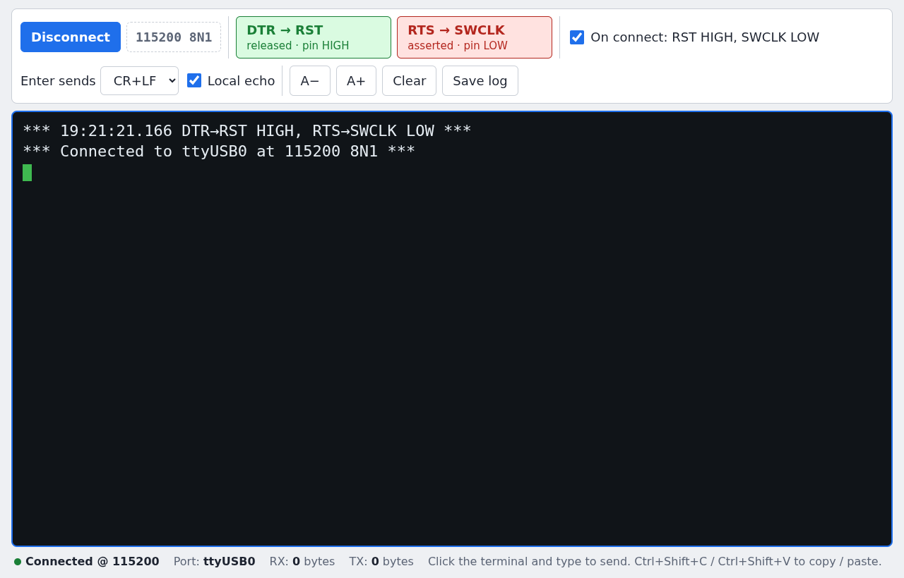
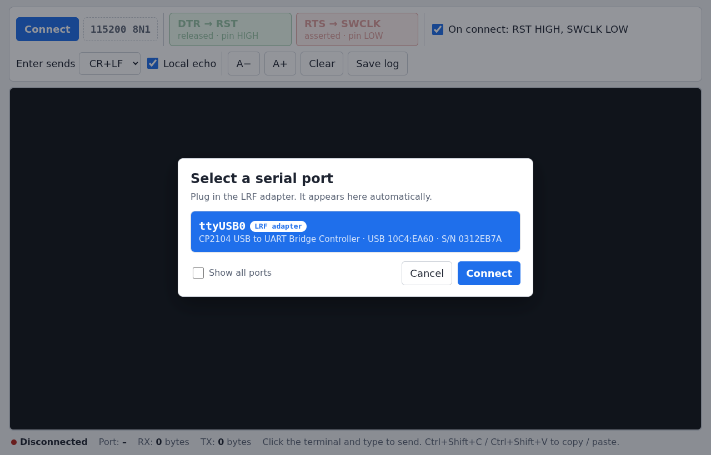

# LRF Terminal

A simple serial terminal for talking to the LRF over its USB adapter. Large, readable text, one-click connect, and buttons for the RST and SWCLK lines.



## Download

| Operating system | Download |
|---|---|
| **Windows** 10 / 11 (64-bit) | [LRF-Terminal-Setup.exe](https://github.com/Nat-As/LRF-Terminal/releases/latest/download/LRF-Terminal-Setup.exe) |
| **macOS** (Apple Silicon and Intel) | [LRF-Terminal.dmg](https://github.com/Nat-As/LRF-Terminal/releases/latest/download/LRF-Terminal.dmg) |
| **Linux** — Ubuntu / Debian | [LRF-Terminal.deb](https://github.com/Nat-As/LRF-Terminal/releases/latest/download/LRF-Terminal.deb) |
| **Linux** — any distribution | [LRF-Terminal.AppImage](https://github.com/Nat-As/LRF-Terminal/releases/latest/download/LRF-Terminal.AppImage) |

These links always point to the newest version. Older versions are on the [Releases page](https://github.com/Nat-As/LRF-Terminal/releases).

## Installation

### Windows

1. Download **[LRF-Terminal-Setup.exe](https://github.com/Nat-As/LRF-Terminal/releases/latest/download/LRF-Terminal-Setup.exe)** and run it.
2. If Windows shows **"Windows protected your PC"**, click **More info**, then **Run anyway**.
3. Follow the installer. It adds **LRF Terminal** to the Start menu and the desktop.
4. Plug in the LRF adapter. Windows normally installs its driver automatically the first time.
   If the adapter never shows up in LRF Terminal, install the
   [Silicon Labs CP210x driver](https://www.silabs.com/developers/usb-to-uart-bridge-vcp-drivers) and plug it in again.

To uninstall, use **Settings → Apps → Installed apps → LRF Terminal → Uninstall**.

### macOS

1. Download **[LRF-Terminal.dmg](https://github.com/Nat-As/LRF-Terminal/releases/latest/download/LRF-Terminal.dmg)** and open it.
2. Drag **LRF Terminal** into the **Applications** folder.
3. Open **LRF Terminal** from Applications. The first time, macOS will say it can't verify the app:
   - Click **Done** (or **OK**), then open **System Settings → Privacy & Security**.
   - Scroll down to the message about LRF Terminal and click **Open Anyway**, then confirm.
   - You only need to do this once.
4. If macOS instead says the app **"is damaged and can't be opened"**, open **Terminal** and run:
   ```
   xattr -cr "/Applications/LRF Terminal.app"
   ```
   Then open the app again.
5. Plug in the LRF adapter. If it doesn't appear in the port list, install the
   [Silicon Labs CP210x driver for macOS](https://www.silabs.com/developers/usb-to-uart-bridge-vcp-drivers), restart, and try again.

To uninstall, drag **LRF Terminal** from Applications to the Trash.

### Linux

**Ubuntu, Debian, Linux Mint, Pop!\_OS (.deb):**

1. Download **[LRF-Terminal.deb](https://github.com/Nat-As/LRF-Terminal/releases/latest/download/LRF-Terminal.deb)**.
2. Install it from a terminal in your Downloads folder:
   ```
   sudo apt install ./LRF-Terminal.deb
   ```
3. Start **LRF Terminal** from your applications menu.

**Any other distribution (AppImage):**

1. Download **[LRF-Terminal.AppImage](https://github.com/Nat-As/LRF-Terminal/releases/latest/download/LRF-Terminal.AppImage)**.
2. Make it executable and run it:
   ```
   chmod +x LRF-Terminal.AppImage
   ./LRF-Terminal.AppImage
   ```
   On Ubuntu 22.04 and newer, if it doesn't start, install FUSE first: `sudo apt install libfuse2` (Ubuntu 24.04 and newer: `sudo apt install libfuse2t64`).

**Allow access to serial ports (one time, both methods):**

```
sudo usermod -aG dialout $USER
```

Then **log out and back in** (or restart). On Arch-based distributions use the `uucp` group instead of `dialout`.

To uninstall the .deb: `sudo apt remove lrf-terminal`. To remove the AppImage, delete the file.

## Usage

### Connecting

1. Plug in the LRF adapter.
2. Click **Connect**. A window lists the serial ports it finds. The LRF adapter is marked **LRF adapter** and is selected for you.

   

   The port name depends on your computer: something like **COM3** on Windows, **cu.usbserial-…** on macOS, or **ttyUSB0** on Linux.
   If you need a port that isn't listed, tick **Show all ports**.
3. Click **Connect** (or double-click the port). The status bar at the bottom turns green and shows **Connected @ 115200**.

The connection is always **115200 baud, 8N1**. There's nothing to configure.

To disconnect, click **Disconnect**. Unplugging the adapter also disconnects automatically.

### Sending commands

- Click inside the black terminal area and type. Each key is sent as you press it.
- **Enter** sends the line ending chosen in **Enter sends** (CR+LF by default).
- **Local echo** shows what you type in the terminal. Turn it off if the LRF already echoes your typing back.
- To paste a command: **Ctrl+V** or **Ctrl+Shift+V** on Windows and Linux, **⌘V** on macOS. Pasted text is sent straight to the LRF.
- To copy text from the terminal, select it with the mouse, then press **Ctrl+Shift+C** on Windows and Linux or **⌘C** on macOS.

### RST and SWCLK buttons

The two coloured buttons control the adapter's **DTR → RST** and **RTS → SWCLK** lines. Click a button to toggle that line.

| Button colour | Meaning |
|---|---|
| **Green** — *released · pin HIGH* | The line is high |
| **Red** — *asserted · pin LOW* | The line is low |

With **On connect: RST HIGH, SWCLK LOW** ticked (the default), every new connection starts with RST high and SWCLK low, so the LRF runs normally.
For example, to reset the LRF: click **DTR → RST** (turns red, RST low), then click it again (turns green, RST high).

Every change to these lines is noted in the terminal with a timestamp.

### Other controls

| Control | What it does |
|---|---|
| **A− / A+** | Make the terminal text smaller or larger. The size is remembered. |
| **Clear** | Clear the terminal. |
| **Save log** | Save everything in the terminal to a text file. |

The status bar shows the connected port and how many bytes have been received (RX) and sent (TX).

## Updating

Download the newest version from the links above and install it the same way. It replaces the old version.
